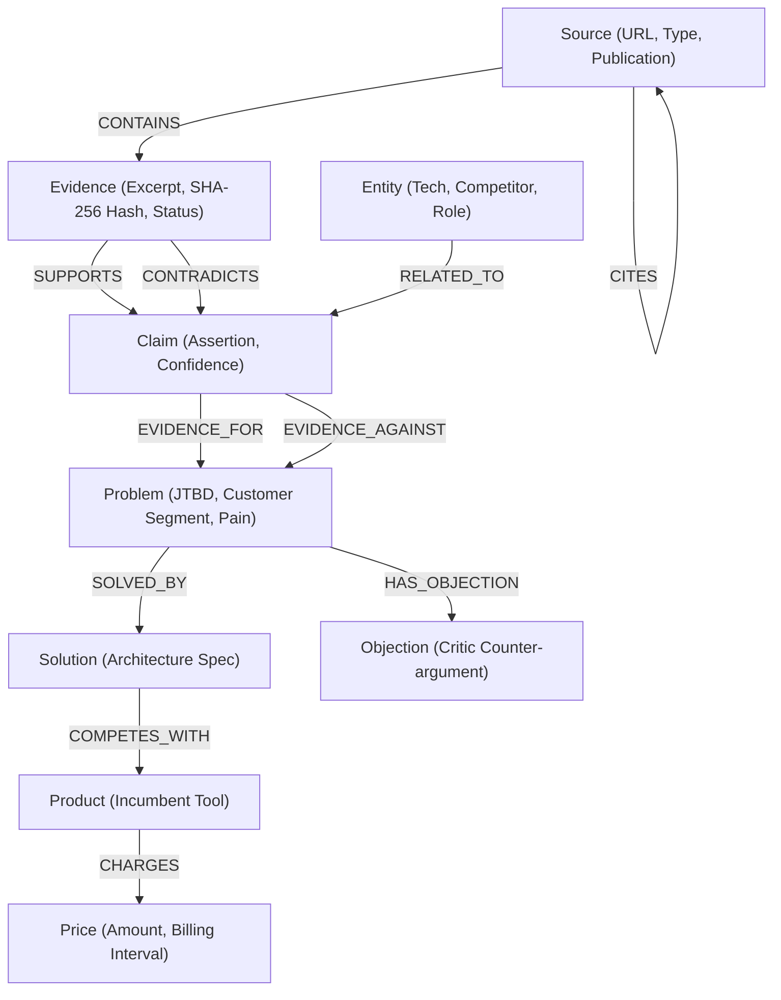

# ankor

> **Autonomous Commercial Validation Engine & Epistemic Knowledge Graph**

ankor is an autonomous multi-agent commercial validation platform that subjects software ideas, market assumptions, and customer pain points to empirical evidence gathering, adversarial critique, unit economic profiling, and graph-backed provenance tracking.

---

## Architecture Overview

ankor maintains a strict separation of concerns between transactional state and graph-based evidentiary reasoning:

- **PostgreSQL**: System of record for projects, execution runs, agent tasks, event streams, human approval gates, cost ledgers, and solution specifications.
- **FalkorDB**: High-throughput graph engine for evidence nodes, atomic claims, entity clustering, provenance lineage traversal, contradiction detection, and hybrid context retrieval.

```text
                               ANKOR
                                 |
                         Agent Runtime
                                 |
                 +---------------+---------------+
                 |                               |
            PostgreSQL                       FalkorDB
         System of Record                 Evidence Graph
                 |                               |
                 |                       +-------+-------+
                 |                       |               |
          Projects / Runs            Graph Data      Retrieval
          Agent Workflows            Claims          Lineage Traversal
          Events & Logs              Sources         Contradiction Check
          Human Approvals            Entities        Hybrid Search
          Inference Costs            Problems        Independence Filter
          Solution Specs             Solutions
                                     Objections
                                         |
                                         v
                                    Agent Context
```

---

## Graph Data Model

ankor represents evidence and commercial relationships using a structured OpenCypher-compatible property graph:



### Core Nodes

- **Source**: Originating publication, forum thread, interview document, or platform.
- **Evidence**: Empirical excerpt with metadata, retrieval method, and cryptographic SHA-256 content hash.
- **Claim**: Atomic factual assertion synthesized by agents from one or more evidence items.
- **Problem**: Quantified customer friction anchor containing Job-to-be-Done (JTBD), hours lost, and commercial rating.
- **Entity**: Extracted technology, company name, developer workflow, or job role.
- **Solution**: Iterative architectural specification addressing the validated problem.
- **Objection**: Adversarial refutation raised by the Critic agent.
- **Product & Price**: Market landscape entities anchoring willingness-to-pay benchmarks.

---

## Epistemic Epistemology

Every Claim and Evidence item is explicitly classified under a formal epistemology:

- `OBSERVED`: Direct verbatim quote from customer review, support ticket, or forum discussion.
- `VERIFIED`: Independently corroborated by multiple distinct non-citing sources.
- `INFERRED`: Deductive conclusion drawn through analytical reasoning.
- `ASSUMED`: Unverified baseline hypothesis or working premise.
- `SIMULATED`: Output generated by synthetic persona runs or simulations.
- `UNKNOWN`: Unclassified or untrusted data.

> **Epistemic Invariant**: Agents are strictly prohibited from silently promoting epistemic status (e.g. converting `SIMULATED` into `OBSERVED`, or `ASSUMED` into `VERIFIED`). All downstream confidence models deterministically down-weight lower epistemic tiers.

---

## Autonomous Multi-Agent Runtime

ankor runs 9 specialized agents in a coordinated orchestration loop:

1. **Captain Sterling** (Orchestrator): Oversees run lifecycle, budget caps, stopping rules, and agent handoffs.
2. **Ranger Knox** (Scout): Queries external APIs, developer discussions, and customer forums for raw signals.
3. **Verity Cross** (Evidence Auditor): Formats evidence nodes, calculates SHA-256 content hashes, and assigns epistemic labels.
4. **Silas Thorne** (Problem Framer): Identifies core JTBD, financial and time losses, and customer segment boundaries.
5. **Julian Price** (Economic Analyst): Runs unit economic calculations (LTV, CAC, gross margin, inference COGS, break-even).
6. **Tess Calder** (Solution Architect): Drafts initial architectural specs and implementation blueprints.
7. **Malik Vance** (Critic): Adversarially stresses the solution with critical, blocking objections.
8. **Rowan Finch** (Hardener): Refines and hardens the specification to Version 2 addressing all blocking objections.
9. **Astrid Bell** (Broadcaster): Synthesizes customer-ready executive briefings and go-to-market summaries.

---

## Getting Started

### Prerequisites

- Node.js 18.x or 20.x+
- FalkorDB instance (local Docker or FalkorDB Cloud)
- OpenRouter API key (for live LLM inference)

### Installation

```bash
# Clone the repository
git clone https://github.com/your-org/ankor.git
cd ankor

# Install dependencies
npm install
```

### Environment Configuration

Create a `.env.local` file in the root directory:

```env
# FalkorDB Graph Layer
FALKORDB_URL=redis://localhost:6379
FALKORDB_USERNAME=
FALKORDB_PASSWORD=
FALKORDB_DATABASE=ankor

# OpenRouter LLM API
OPENROUTER_API_KEY=your_openrouter_api_key_here
OPENROUTER_BASE_URL=https://openrouter.ai/api/v1
OPENROUTER_DEFAULT_MODEL=anthropic/claude-3.5-sonnet

# App URL
NEXT_PUBLIC_APP_URL=http://localhost:3000
```

### Development Server

```bash
npm run dev
```

Navigate to `http://localhost:3000` to interact with the dashboard, launch validation runs, and explore the interactive FalkorDB knowledge graph.

### Running Automated Test Suite

ankor includes a comprehensive 37-point automated verification suite testing unit economic arithmetic, Zod schemas, provenance hashing, stopping rules, and FalkorDB graph retrievals:

```bash
npx tsx scripts/test-runner.ts
```

### Production Build

```bash
npm run build
```

---

## Deployment to Vercel

1. **Repository**: Push the codebase to your GitHub repository.
2. **Import Project**: In the Vercel Dashboard, import the repository.
3. **Environment Variables**: Configure the following production environment variables in Vercel Project Settings:
   - `FALKORDB_URL`: FalkorDB Cloud endpoint (e.g. `redis://...cloud:60624`)
   - `FALKORDB_USERNAME`: FalkorDB user (e.g. `falkordb`)
   - `FALKORDB_PASSWORD`: FalkorDB instance password
   - `FALKORDB_DATABASE`: Target graph name (e.g. `ankor`)
   - `OPENROUTER_API_KEY`: OpenRouter API key
   - `OPENROUTER_DEFAULT_MODEL`: Target model identifier
4. **Deploy**: Trigger a clean build. Next.js is pinned to `15.5.28` to satisfy all security and deployment requirements.

---

## Technical Documentation

For deep technical details on OpenCypher syntax, traversal patterns, contradiction queries, and epistemic algorithms, see:

- [OpenCypher Queries & Graph Algorithms Documentation](file:///c:/Users/Dell/Downloads/ankor/docs/CYPHER_QUERIES_AND_GRAPH_ALGORITHMS.md)

---

## License

MIT License. Designed and engineered for evidence-backed commercial validation.
